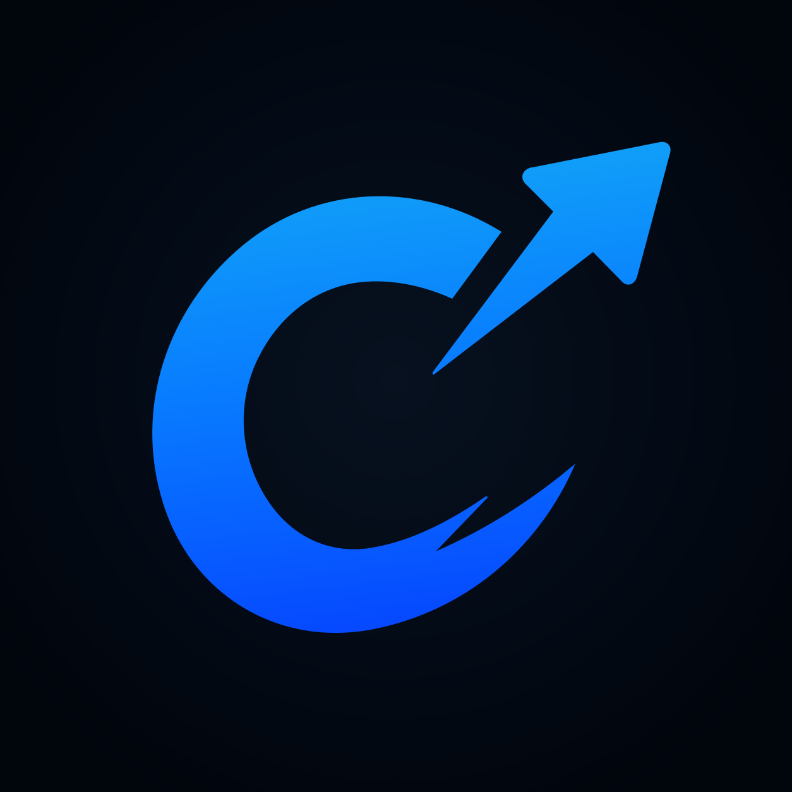
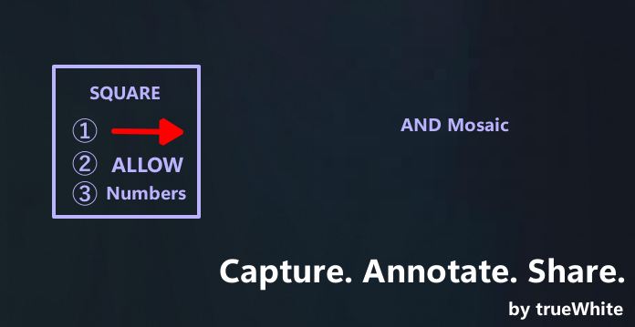
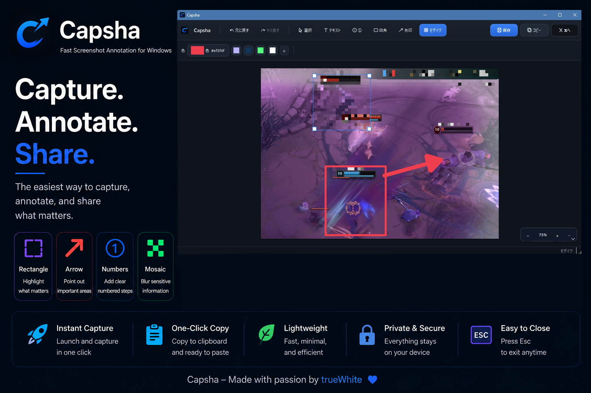

<p align="center">
  
</p>

<h1 align="center">Capsha</h1>

<p align="center">
  <strong>Capture. Annotate. Share.</strong>
</p>

<p align="center">
  <a href="README.md">English</a> | 日本語
</p>

<p align="center">
  Windows向けの、クリップボード優先スクリーンショット注釈ツール。
</p>

<p align="center">
  <a href="https://ko-fi.com/truewhite">
    
  </a>
</p>

<p align="center">
  
  
  
  
</p>

---

## 📸 スクリーンショット

<table align="center">
  <tr>
    <th>Concept</th>
    <th>In Action</th>
  </tr>
  <tr>
    <td></td>
    <td></td>
  </tr>
</table>

## ✨ 概要

Capshaは、毎日スクリーンショットを共有する人のために作られた軽量なスクリーンショット注釈ツールです。

Capshaが重視するのは、画像編集そのものではなく**速度**です。

撮影からクリップボード、注釈、保存、共有まで、すべての操作はクリック数を最小限にするよう設計されています。

---

## ⚡ クイックスタート

最速で使うには、CapshaをWindowsのタスクバーへピン留めしてください。

workflow:

1. **Capsha**をWindowsのタスクバーへピン留めします。
2. **Win + 1**（または配置に対応する数字キー）を押して一瞬で起動します。
3. 撮影、注釈、コピー、共有を行います。

これがCapshaを最速で使う方法です。

---

## 🚀 機能

- ⚡ 即時の範囲キャプチャ
- ✏️ テキスト注釈
- ▭ 四角注釈
- ➜ 矢印注釈
- 🟪 モザイク / ぼかし
- 📋 クリップボード優先ワークフロー
- 🔁 流れを止めない再撮影
- 💾 PNG書き出し
- 𝕏 X投稿画面を開く
- 🌐 日本語 / 英語UI
- 🖥 マルチモニター対応
- 🎨 モダンなWindows UI

---

## 💡 哲学

多くのスクリーンショットツールは、画像を編集するために作られています。

Capshaは、画像を**共有するため**に作られています。

> スクリーンショットを撮影してから共有するまでの時間を短くする。

---

## 💡 Tips

**再撮影**を押すと、すぐに新しい撮影を開始します。現在の注釈は破棄され、撮影のテンポを保つため確認ダイアログは表示されません。

---

## 関連ドキュメント

- [設計哲学](DESIGN.ja.md)

---

## 📦 インストール

GitHub Releasesから最新リリースをダウンロードしてください。

https://github.com/hakujolno/capsha/releases

ZIPを展開して起動します。

```text
Capsha.exe
```

インストールは不要です。

---

## ⌨️ キーボードショートカット

| ショートカット | 操作 |
|----------|--------|
| Esc | 終了 |
| Ctrl + Z | 元に戻す |
| Ctrl + Y | やり直す |
| Ctrl + C | コピー |
| Ctrl + S | 保存 |
| Ctrl + Shift + S | 名前を付けて保存 |

---

## 🛠️ ビルド

```bash
git clone https://github.com/hakujolno/capsha.git
cd capsha

python -m venv .venv
pip install -r requirements.txt

python main.py
```

---

## 🔨 実行ファイルのビルド

```powershell
scripts/build_release.ps1
```

または

```bash
pyinstaller capsha.spec
```

---

## 🗺️ ロードマップ

- [x] クリップボード優先ワークフロー
- [x] 高速な注釈
- [x] 多言語対応(en, jp)
- [ ] 自動アップデート
- [ ] macOS対応
- [ ] OCR
- and more...
---

## 🤝 コントリビュート

Issue、Pull Request、機能リクエスト、フィードバックはいつでも歓迎です。

---

## ❤️ サポート

Capshaは空き時間に開発・保守されています。

Capshaが時間短縮に役立ったら、開発支援をご検討ください。

皆さまの支援は、新機能、バグ修正、今後のリリースに活用されます。

<a href="https://ko-fi.com/truewhite">
  
</a>

---

## 📄 ライセンス

MIT License

---

<p align="center">
Made with ❤️ by <strong>trueWhite</strong>
</p>
